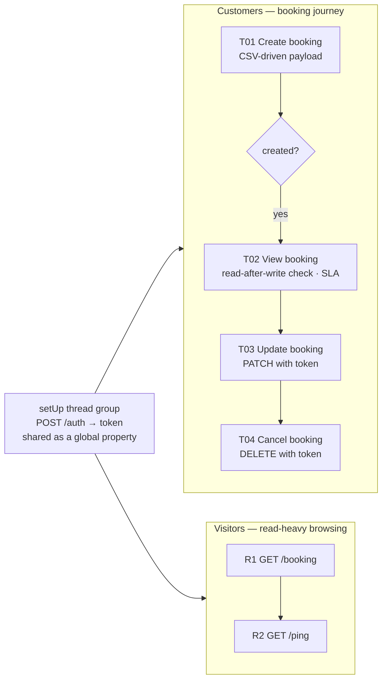

# JMeter Performance Testing — Booking API

[](https://github.com/AishwaryaAni/jmeter-performance-testing/actions/workflows/performance.yml)
[](https://aishwaryaani.github.io/jmeter-performance-testing/)


Load, stress and smoke performance testing of a hotel-booking REST API with **Apache JMeter**, fully automated in CI:
the pipeline **starts the system under test in Docker**, drives realistic user journeys at three load levels,
enforces **SLA quality gates** (error rate, p95 latency, throughput) and publishes the **JMeter HTML dashboards** to GitHub Pages.

### 📈 [View the live results & dashboards →](https://aishwaryaani.github.io/jmeter-performance-testing/)

> Built by a QA Team Lead who has run JMeter load and stress tests simulating 5,000+ concurrent users in production programmes. This repo shows the method end to end — workload model, test data, assertions, thresholds, and evidence — in a form anyone can re-run.

---

## Why the API runs in Docker

Load-testing a shared public demo site would degrade it for everyone else. Here the workflow starts its **own throwaway copy** of the API (`mwinteringham/restfulbooker`) as a service container next to JMeter. The load is real, the target is isolated, and the results are reproducible — the same setup teams use for performance checks in CI.

---

## Workload model



Two populations run concurrently, like real traffic: **customers** who write (create → view → update → cancel, cleaning up after themselves) and **visitors** who only read.
Each step is a JMeter **Transaction Controller**, so the dashboard reports business transactions, not only raw requests.

| Profile | Customers | Visitors | Ramp-up | Duration | Purpose | Runs |
|---|---|---|---|---|---|---|
| `smoke`  | 2  | 1  | 5 s  | 30 s  | Script + system sanity at minimal load | every push |
| `load`   | 20 | 10 | 30 s | 2 min | Expected peak, steady state | every push |
| `stress` | 60 | 30 | 90 s | 4 min | ~3× peak — where does it degrade? | nightly / on demand |

---

## SLA quality gates

`scripts/check-thresholds.js` reads the dashboard's `statistics.json`, compares it with `thresholds/<profile>.json`, writes a results table into the GitHub run summary, and **fails the build if any SLA is breached** — a slow release fails like a broken one.

| Profile | Max error rate | Max p95 (overall) | Per-transaction p95 | Min throughput |
|---|---|---|---|---|
| `smoke`  | 0 % | 1500 ms | T01 ≤ 1500 · T02 ≤ 1000 | – |
| `load`   | 1 % | 2000 ms | T01/T03/T04 ≤ 2000 · T02 ≤ 1500 | 5 req/s |
| `stress` | 5 % | 5000 ms | – | – |

Dashboards are published **even when a gate fails**, so a red build always comes with the evidence.

---

## What the test plan demonstrates

| JMeter technique | Where |
|---|---|
| **setUp Thread Group** + JSON Extractor + JSR223 (Groovy) to share an auth token across thread groups via `props` | `setUp - obtain auth token` |
| **CSV Data Set Config** — 60 realistic bookings, shared across threads, recycled | `test-plans/data/bookings.csv` |
| **Correlation** — `bookingid` extracted from the create response and reused in GET/PATCH/DELETE | `Extract bookingid` |
| **If Controller** — skip dependent steps when creation fails (no cascading false errors) | `Only continue if the booking was created` |
| **Assertions**: response code, JSONPath value, body substring (read-after-write integrity), **Duration (SLA)** | every sampler |
| **Transaction Controllers** for business-level timings | `T01`–`T04` |
| **Uniform Random Timer** think time — realistic pacing, not a hammer | both thread groups |
| **Fully parameterised** — host, port, users, ramp-up, duration, think time, SLA via `-J` / `-q` properties (`${__P(…)}`) | User Defined Variables |
| **Non-GUI execution + HTML dashboard** (`-n -e -o`) | CI + `run-local.sh` |

---

## Project Structure

```
jmeter-performance-testing
├── .github/workflows/performance.yml   # Docker SUT → JMeter matrix → SLA gate → Pages
├── docker-compose.yml                  # same SUT for local runs
├── test-plans/
│   ├── booking-api-load-test.jmx       # the JMeter test plan
│   └── data/bookings.csv               # 60 rows of test data
├── profiles/      smoke · load · stress .properties   # workload settings
├── thresholds/    smoke · load · stress .json         # SLA gates
├── scripts/
│   ├── check-thresholds.js             # quality gate + Markdown summary
│   └── run-local.sh                    # one-command local run
└── site/index.html                     # results landing page (GitHub Pages)
```

---

## Run it locally

**Prerequisites:** Java 17+, [Apache JMeter 5.6.3](https://jmeter.apache.org/download_jmeter.cgi), Docker, Node 18+.

```bash
git clone https://github.com/AishwaryaAni/jmeter-performance-testing.git
cd jmeter-performance-testing

docker compose up -d                 # start the API on :3001

./scripts/run-local.sh smoke         # run + SLA gate → results/smoke/dashboard/index.html
./scripts/run-local.sh load

# or call JMeter directly with any overrides
jmeter -n -t test-plans/booking-api-load-test.jmx -q profiles/load.properties \
       -Jusers=40 -Jduration=300 -l results/run.jtl -e -o results/run-dashboard

# open the plan in the JMeter GUI to explore or edit it
jmeter -t test-plans/booking-api-load-test.jmx

docker compose down
```

On GitHub: **Actions → Performance Tests → Run workflow** and pick a profile.

---

## Reading the results

Each profile's dashboard includes the APDEX table, response-time percentiles over time, throughput vs. active threads, latency vs. request rate, and error breakdowns. The run summary in Actions shows the gate table (samples, error %, mean / p90 / p95 / p99, req/s) for every transaction and profile.

---

## Related repositories

| Repo | Focus |
|---|---|
| 🖥️ [saucedemo-selenium-framework](https://github.com/AishwaryaAni/saucedemo-selenium-framework) | Selenium + TestNG, Page Object Model |
| 🔌 [restful-booker-api-automation](https://github.com/AishwaryaAni/restful-booker-api-automation) | REST Assured functional API testing |
| 🥒 [cucumber-selenium-grid-framework](https://github.com/AishwaryaAni/cucumber-selenium-grid-framework) | BDD, Selenium Grid on Docker, cross-browser |
| 🛒 [ecommerce-e2e-automation-framework](https://github.com/AishwaryaAni/ecommerce-e2e-automation-framework) | Hybrid UI + API end-to-end |
| 📈 **jmeter-performance-testing** | Load / stress testing with SLA gates |

## Author

**Aishwarya Anil** — Senior QA Engineer · QA Team Lead
Manual · API · Database · UI Automation · Performance

[LinkedIn](https://linkedin.com/in/aishwarya-anil20) · [GitHub](https://github.com/AishwaryaAni)
